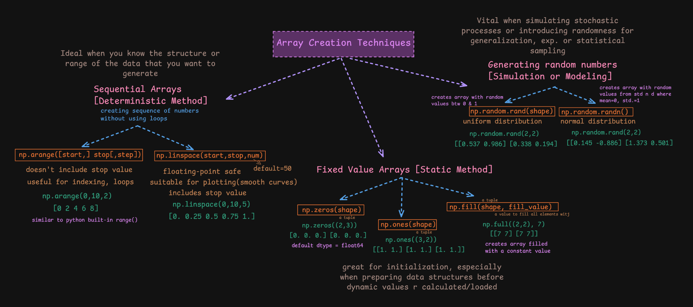

# NumPy Array Creation Techniques

NumPy provides different ways to create arrays depending on whether values are sequential, fixed, or random.



## 1. Sequential arrays

### `np.arange()`

Creates values using a start, stop, and step. The stop value is excluded.

```python
np.arange(0, 10, 2)
# array([0, 2, 4, 6, 8])
```

Useful when you need a sequence with a fixed step.

### `np.linspace()`

Creates a specified number of evenly spaced values between start and stop. The stop value is included by default.

```python
np.linspace(0, 10, 5)
# array([ 0. ,  2.5,  5. ,  7.5, 10. ])
```

Useful when you need a fixed number of points, for example when preparing values for a plot.

## 2. Fixed-value arrays

| Function | Purpose | Example |
|---|---|---|
| `np.zeros(shape)` | Creates an array filled with zeros | `np.zeros((2, 3))` |
| `np.ones(shape)` | Creates an array filled with ones | `np.ones((3, 2))` |
| `np.full(shape, value)` | Fills an array with a chosen value | `np.full((2, 2), 7)` |

These are useful for initialising arrays before filling them with calculated or loaded values.

## 3. Random arrays

- `np.random.rand(shape)` — random values from a uniform distribution over `[0, 1)`.
- `np.random.randn(shape)` — random values from the standard normal distribution.

Example:

```python
np.random.rand(2, 2)
np.random.randn(2, 2)
```

Random values are useful for simulations, modelling, and sampling exercises.

For new projects, NumPy also recommends using a random `Generator` created with `np.random.default_rng()`:

```python
rng = np.random.default_rng(seed=42)
values = rng.random((2, 2))
```

## Important distinction

- `arange`: specify the step.
- `linspace`: specify the number of values.
- `zeros`, `ones`, `full`: initialise with fixed values.
- Random functions: generate values according to a distribution.

## Official reference

[Array creation routines](https://numpy.org/doc/stable/user/basics.creation.html)
