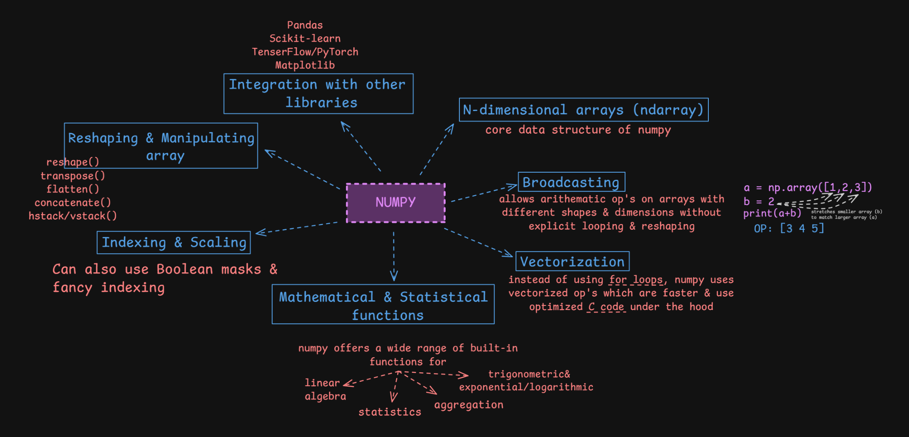

# Core NumPy Concepts

These concepts explain how NumPy arrays can be transformed and operated on efficiently.



## 1. Reshaping and manipulating arrays

| Function | Purpose |
|---|---|
| `reshape()` | Changes the array shape without changing its data |
| `transpose()` | Permutes the array axes |
| `flatten()` | Returns a flattened copy |
| `concatenate()` | Joins arrays along an existing axis |
| `hstack()` | Stacks arrays horizontally |
| `vstack()` | Stacks arrays vertically |

Example:

```python
arr = np.arange(6)

arr.reshape(2, 3)
```

The requested new shape must be compatible with the number of elements.

## 2. Broadcasting

Broadcasting allows NumPy to perform operations on arrays with compatible shapes without manually repeating values.

```python
a = np.array([1, 2, 3])
b = 2

a + b
# array([3, 4, 5])
```

Here, the scalar is applied to each element of the array.

Broadcasting also works between some arrays with different shapes, provided their dimensions are compatible.

## 3. Vectorization

Vectorization means expressing operations on whole arrays rather than explicitly looping through individual elements in Python.

```python
arr = np.array([1, 2, 3])

arr * 2
# array([2, 4, 6])
```

NumPy's array operations are implemented using optimised low-level code, which can make numerical work more efficient than equivalent Python-level loops.

## 4. Mathematical and statistical functions

NumPy provides built-in functions for:

- Linear algebra.
- Aggregations.
- Statistics.
- Trigonometric operations.
- Exponential and logarithmic operations.

Examples:

```python
arr = np.array([10, 20, 30, 40])

np.sum(arr)
np.mean(arr)
np.median(arr)
np.std(arr)
np.min(arr)
np.max(arr)
```

For multidimensional arrays, learn how the `axis` argument changes the direction of an operation.

## 5. Integration with other libraries

NumPy arrays are commonly used with:

- Pandas
- Matplotlib
- scikit-learn
- TensorFlow
- PyTorch

NumPy provides a numerical foundation used across much of the Python data and scientific-computing ecosystem.

## What to practise

1. Reshape a 1D array into a 2D array.
2. Select rows and columns from a matrix.
3. Filter values using a Boolean condition.
4. Add a scalar to an array using broadcasting.
5. Calculate summary statistics for an array.
6. Join two arrays along a chosen axis.

## Official reference

[NumPy user guide](https://numpy.org/doc/stable/user/)

